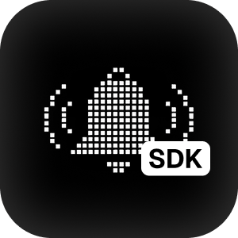

<div align="center">
  
  <h1>Notifiable - React Native SDK</h1>
</div>

---

`@notifiable/react-native` registers a React Native install with [Notifiable](https://notifiable.sh), asks for notification permission, and identifies the person using the app. From the same hook you can list their inbox, record that they opened or tapped a notification, and send events.

Import from `@notifiable/react-native`.

## Install

```bash
npm install @notifiable/react-native
npm install @react-native-async-storage/async-storage
```

The package needs `react` 18 or newer and `react-native` 0.73 or newer. AsyncStorage keeps the subscriber on the device between launches. If the app already has another store, pass it as `storage` and skip AsyncStorage.

This package does not include Firebase, APNs, or Expo. Your app supplies permission and the device token. Rebuild the iOS and Android app after installing so the device model, app version, and the real bundle id or package name are available.

## Configure

Wrap the app in `NotifiableProvider`. It connects on mount. Permission is asked only when you call it from a button, or when the dashboard asks for the prompt.

```tsx
import { NotifiableProvider, useNotifiable } from "@notifiable/react-native";

function App() {
  return (
    <NotifiableProvider
      publicKey="ntf_pub_..."
      push={{
        provider: "fcm",
        getPermissionStatus,
        requestPermission,
        getToken,
      }}
      deepLinks={[
        { path: "/orders", label: "Orders" },
        { path: "/inbox", label: "Inbox" },
      ]}
      onDeepLink={(url) => {
        // Open this route in your navigator.
      }}
    >
      <Home />
    </NotifiableProvider>
  );
}
```

| Prop | What you pass |
| --- | --- |
| `publicKey` | The key from the Notifiable dashboard. |
| `push` | How this app reads permission and the device token. |
| `deepLinks` | Screens Notifiable can link to. Each one is `{ path, label }`. Saved when connect succeeds. |
| `onDeepLink` | Called with a notification url when someone taps a development preview. |
| `storage` | Your own `getItem` / `setItem` / `removeItem` store. Omit it to use AsyncStorage. |
| `logger` | Optional `debug`, `info`, `warn`, and `error` callbacks. |
| `client` | A client you already built with `createNotifiable`. The provider starts that client and ignores `publicKey`. |

### Public key

Create the key in the Notifiable dashboard and pass it as `publicKey`. A blank key throws before the app connects.

Use the **development** key while you build, including on the iOS simulator and the Android emulator. Use the **production** key in the build you ship. The key is what switches the app between those two modes. Keep the two keys in the matching build config, for example a dev env file and a release env file, and pass the one for the current build:

```tsx
<NotifiableProvider publicKey={publicKey} push={push}>
  <App />
</NotifiableProvider>
```

The same install is remembered on the device. Opening the app again updates that subscriber instead of creating a new one. Permission can stay denied or undecided. The subscriber still exists.

### Push

`push.provider` is `"apns"`, `"fcm"`, `"expo"`, or `"web_push"`.

```ts
const push = {
  provider: "fcm" as const,
  getPermissionStatus: () => Promise.resolve(status),
  requestPermission: () => askTheOperatingSystem(),
  getToken: () => Promise.resolve(token),
};
```

`getPermissionStatus` is optional. `requestPermission` returns `"granted"`, `"denied"`, or `"not_determined"`. `getToken` returns the device token, or `null` when there is none.

The token is saved only after permission is granted and `getToken()` returns a string. If permission is granted and the token is empty, the call fails with `missing_token` and that grant is not saved.

### Permission

Ask in either of these ways. Both go through `push.requestPermission` and then save the answer.

**From a button.** Call `requestPermission()` at the moment you choose, usually after a short explanation.

```tsx
function EnableNotifications() {
  const { requestPermission } = useNotifiable();

  return (
    <Button
      title="Enable notifications"
      onPress={() => {
        void requestPermission();
      }}
    />
  );
}
```

**Automatically.** In the Notifiable dashboard, ask this subscriber for permission. The next time the app connects, the system prompt opens on its own. That includes a later request after the person denied or dismissed the first one. Connect does not ask when the dashboard has not requested it.

## Development and production

| | Development key | Production key |
| --- | --- | --- |
| First launch | A sheet asks you to show or hide the Notifiable mark | No sheet |
| On screen | A draggable mark. Tap it to compare this app's bundle id or package name with the dashboard | Nothing from Notifiable is drawn over the app |
| Notifications | A notification you send from the dashboard appears as a toast at the top of the simulator or emulator | Your push provider displays the notification |
| Diagnostics | Failed SDK calls can be shared with Notifiable. The switch starts on | Nothing is sent |

### See a notification on a simulator or emulator

A development key polls for new notifications while the app is in the foreground, after notification permission is granted. Send one from the dashboard and it shows at the top of the iOS simulator or Android emulator. You can check the title, the tap, and the route without a physical device and without a push certificate.

The toast stays up for a recent unread alert, records the open, and calls `onDeepLink` with the url when someone taps it. A tap also records a click when the notification has a delivery.

On the iOS simulator, Command N shows the mark again, including while a text field is focused.

The mark's sheet compares the dashboard bundle id or package with the identifier of the app you are running. A match shows a green check. A mismatch shows what to paste into the dashboard, with a copy button. Share SDK diagnostics, on that same sheet, reports a failed SDK call once per launch. Turn it off to stop sending. [Learn what is collected](https://notifiable.sh/sdk-diagnostics).

A production key skips the sheet, the mark, and these previews. People receive notifications through the push provider you passed in `push`.

## useNotifiable

Call `useNotifiable()` in any component under `NotifiableProvider`. It throws `missing_provider` outside that tree. The values update when the subscriber, permission, or last error changes.

```tsx
function Home() {
  const notifiable = useNotifiable();

  if (!notifiable.ready) {
    return <Text>Connecting…</Text>;
  }

  return <Text>{notifiable.subscriber?.id}</Text>;
}
```

Wait until `ready` is true before `identify`, `inbox`, `notification`, `openNotification`, `clickDelivery`, or `track`. Those calls need the subscriber created at connect.

### State

**`ready`** is true after connect has saved the subscriber.

**`permission`** is `"granted"`, `"denied"`, or `"not_determined"`.

**`subscriber`** is the person and device Notifiable stored. It is `null` until connect finishes. `subscriber.id` is the id you will see in the dashboard. `subscriber.externalId` is set after `identify`. `subscriber.anonymousId` is set until you identify them with an email or an external id.

**`clientConfig`** is the app record from the dashboard: name, icon, and whether this key is `development` or `production`. It is `null` until connect finishes.

**`deepLinks`** is the list of routes saved for this app. It is `null` until that save finishes.

**`devIndicator`** is `"enabled"`, `"disabled"`, or `null` if the person has not chosen yet. It remembers whether the development mark is shown.

**`diagnostics`** is `"enabled"`, `"disabled"`, or `null`. It remembers whether development failures are shared. A missing choice means sharing is on.

**`error`** is the last `NotifiableError`, or `null`. Read `error.code` and `error.message`.

**`config`** is the public key, push port, and other options this client was created with.

### `start()`

Connects, or does nothing when the app is already connected. The provider calls this on mount, so most screens never call it. Call it yourself when you built the client with `createNotifiable` and are not using the provider's automatic start, or when you want to retry after `error` is set.

```tsx
await notifiable.start();
```

### `requestPermission()`

Shows the system permission prompt through your `push` port, then saves the result. Use it from a button. The returned value is the new permission.

```tsx
const permission = await notifiable.requestPermission();
```

The same prompt also opens on connect when the dashboard has asked for it. You do not call this function for that case.

### `identify(input)`

Attaches a real person to this device. Call it after your app knows who signed in.

```tsx
const subscriber = await notifiable.identify({
  email: "ada@example.com",
  externalId: "user_123",
  firstName: "Ada",
  lastName: "Lovelace",
});
```

`email`, `externalId`, `firstName`, and `lastName` are all optional, and at least an email or an external id should be set. A blank email or a blank external id is rejected. After an email or an external id is saved, the subscriber is no longer anonymous.

### `inbox(query?)`

Returns one page of this subscriber's notifications. Each page has 20 items. Use it for an inbox screen.

```tsx
const page = await notifiable.inbox();
const unread = await notifiable.inbox({ page: 1, opened: false });
```

`page` chooses the page number. `opened` keeps only opened or only unopened notifications. Leave a field out to skip that filter.

The result is `{ notifications, page, perPage, total }`. Each notification has `id`, `title`, `body`, `url`, `imageUrl`, `opened`, `openedAt`, `createdAt`, and `deliveryId`.

### `notification(id)`

Loads one notification by id. Use it when a screen opens from a known notification id.

```tsx
const item = await notifiable.notification(id);
```

### `openNotification(id)`

Tells Notifiable this subscriber opened that notification. Call it when your inbox marks an item as read.

```tsx
await notifiable.openNotification(id);
```

### `clickDelivery(deliveryId)`

Tells Notifiable the person tapped that delivery. `deliveryId` is `notification.deliveryId`. Call it when they follow the notification, in addition to navigating.

```tsx
if (item.deliveryId) {
  await notifiable.clickDelivery(item.deliveryId);
}
```

A development toast already does this when the preview is tapped.

### `track(name, properties?)`

Records an event for the connected subscriber. You do not pass the subscriber id. Use it for something that happened in the app, such as a completed order.

```tsx
const event = await notifiable.track("order.shipped", {
  order: "1001",
  express: true,
});
```

`name` is required. `properties` is optional: up to 20 keys, and each value is a string, a number, a boolean, or `null`. The result is `{ id, name, subscriberId }`.

### `setDevIndicator(enabled)`

Shows or hides the development mark and remembers the choice on this device. The first-launch sheet calls this for you. Call it when your own settings screen should control the mark.

```tsx
await notifiable.setDevIndicator(true);
```

A production key does not draw the mark.

### `setDiagnostics(enabled)`

Turns sharing of development failures on or off and remembers the choice. The switch on the development sheet calls this for you.

```tsx
await notifiable.setDiagnostics(false);
```

A production key does not send these reports.

## Errors

Failed calls throw `NotifiableError`. `error.code` on the hook is the same code as the last failure.

| Code | What happened |
| --- | --- |
| `invalid_config` | The public key is blank, or permission was requested without `push`. |
| `missing_provider` | `useNotifiable()` is outside `NotifiableProvider`. |
| `invalid_public_key` | Notifiable rejected the key. |
| `network` | The request did not succeed. |
| `validation_failed` | A value was rejected, such as a blank email. |
| `subscriber_not_found` | Connect has not finished, or the subscriber no longer exists. |
| `subscriber_limit` | The project cannot add another subscriber. |
| `rate_limited` | Too many requests. Wait and try again. |
| `missing_token` | Permission is granted and `getToken()` returned nothing. |
| `missing_storage` | AsyncStorage is not installed and `storage` was not passed. |
